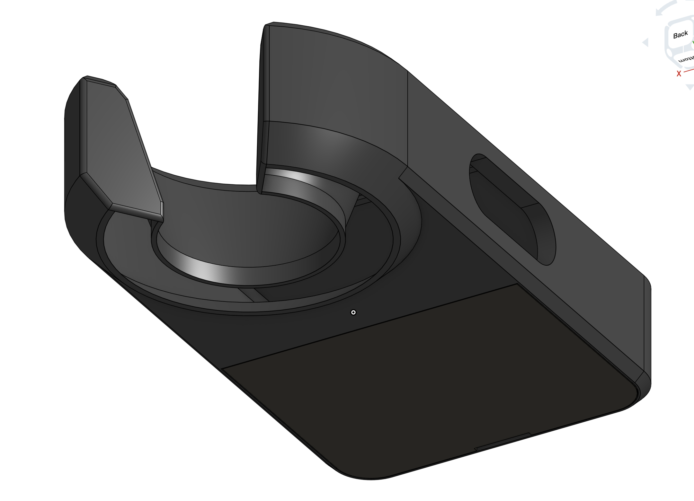

half/life week 2 project: 3d modeling / cad. 
goal: building & printing a functional skin transilluminator inspired by the ledx from one of my favorite games, escape from tarkov.
onshape link:
https://cad.onshape.com/documents/df2d9f2bb4055587da55f60e/w/7b9492fc0faaef16bf68eb27/e/0fc6cdca11fd10a08903b49a?renderMode=0&uiState=6ae24e4288223f158bbd0dd6
step: ledx main.step

THEORHETICALLY orange ledx organized in a compact arc shine beneth the skin and flesh and will highlight veins. however, right now it is just an enclosure, an untested prototype not yet printed and/or assembled with electronics. it has not been tested for finding veins or for helping with injections, and it makes no medical claims.

render of the bottom with the snap-on door. body is pla (matte black) and the door is petg (darker black) so you can tell the two parts apart. petg for the door bc the clips flex every time you open it and pla would snap.

## bom
prices are what you actually pay on amazon (oct 2026), most parts only come in packs so there's lots of spares. [add everything to cart](https://www.amazon.com/gp/aws/cart/add.html?ASIN.1=B08TTTL5BV&Quantity.1=1&ASIN.2=B07PKND8KG&Quantity.2=1&ASIN.3=B07RTJDW27&Quantity.3=1&ASIN.4=B0DHX6HHQ8&Quantity.4=1&ASIN.5=B0DHX6DD85&Quantity.5=1&ASIN.6=B07HDGF48W&Quantity.6=1&ASIN.7=B01CQJKC6E&Quantity.7=1). also in `BOM.csv`.

| item | qty | supplier | cost/item | total cost | link |
| --- | --- | --- | --- | --- | --- |
| 3.7v lipo 1000mah 503450 w/ jst ph2.0 | 1 | amazon | $7.86 | $7.86 | [link](https://www.amazon.com/dp/B08TTTL5BV) |
| hiletgo tp4056 usb-c charger w/ protection (3 pack, uses 1) | 1 | amazon | $5.99 | $5.99 | [link](https://www.amazon.com/dp/B07PKND8KG) |
| hiletgo ss-12d00 slide switch (20 pack, uses 1) | 1 | amazon | $5.39 | $5.39 | [link](https://www.amazon.com/dp/B07RTJDW27) |
| 3mm orange diffused led (100 pack, uses 24) | 1 | amazon | $5.99 | $5.99 | [link](https://www.amazon.com/dp/B0DHX6HHQ8) |
| 3mm red diffused led (100 pack, uses 8) | 1 | amazon | $5.99 | $5.99 | [link](https://www.amazon.com/dp/B0DHX6DD85) |
| 220 ohm 1/4w metal film resistor (100 pack, uses 32) | 1 | amazon | $5.49 | $5.49 | [link](https://www.amazon.com/dp/B07HDGF48W) |
| bntechgo 26awg silicone wire, 10ft red + 10ft black | 1 | amazon | $6.68 | $6.68 | [link](https://www.amazon.com/dp/B01CQJKC6E) |
| pla + petg filament (~30g) | 1 | already have | $0.00 | $0.00 | |
| **total** | | | | **~$43.39** + tax | |
